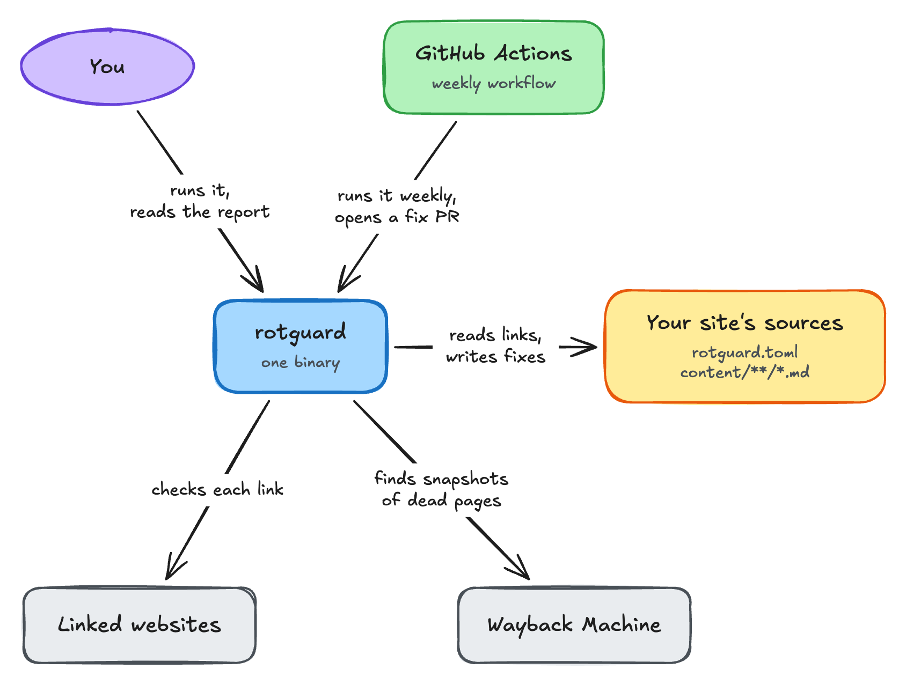

<h1></h1>

[](https://github.com/rdiachenko/rotguard/actions/workflows/ci.yml)
[](#license)
[](https://github.com/marketplace/actions/rotguard-link-checker-fixer)
[](https://github.com/rdiachenko/rotguard/releases)

Checks the outbound links of a markdown site for rot: dead links, redirects and soft-404s
(pages that answer 200 but are really gone). It proposes a fix for each one: the new URL for a
permanent redirect, or a Wayback Machine snapshot for a dead page. With `--apply` it writes those
fixes back into your files.

How rotguard fits around your site:

<picture>
  <source media="(prefers-color-scheme: dark)" srcset="docs/diagrams/overview-dark.png">
  
</picture>

## Install

On Linux, download a static binary from the
[releases page](https://github.com/rdiachenko/rotguard/releases). Set `v` to the latest version
and `arch` to `x86_64` or `aarch64`:

```sh
v=0.1.1 arch=x86_64
curl -fsSLo rotguard "https://github.com/rdiachenko/rotguard/releases/download/v$v/rotguard-$v-$arch-unknown-linux-musl"
chmod +x rotguard && sudo mv rotguard /usr/local/bin/
```

Anywhere else, build it with Rust 1.88 or newer:

```sh
cargo install --locked --git https://github.com/rdiachenko/rotguard
```

## Use

Put a `rotguard.toml` in your site's root (see [Configure](#configure)), then:

```sh
rotguard                 # check the site in the current directory; changes nothing
rotguard path/to/site    # check another directory
rotguard --apply         # also write the proposed fixes into the files
rotguard --strict        # also fail on temporary redirects, unverifiable and blocked links
rotguard --quiet         # no progress lines on stderr; errors still show
rotguard --format json      # the report as JSON, for scripts
rotguard --format html > report.html   # a page to open in a browser
rotguard --format markdown  # the report as markdown, for a PR body
```

The JSON report is an object with `findings` and `summary`. Each finding has `file`, `line`, `url`,
`class`, `chain`, `reason`, `final_url` and `fix` (`null`, or an object with a `kind`); `summary`
holds the counts of the summary line.

Run it without `--apply` first, read the report, then run it again with `--apply`.

To run it every week and get the fixes as a pull request, see
[docs/github-actions.md](docs/github-actions.md); pin the action to `@v0`.

## Configure

Only `site_url` is required. Links to its host count as internal and are not checked.

```toml
site_url = "https://example.com"

# Optional; the values shown are the defaults.
content = ["content/**/*.md"]   # files to scan, relative to the site root
date_key = "date"               # front-matter key whose date picks the snapshot
ignore = []                     # regexes; matching URLs are skipped
deadline_s = 300                # links unfinished by then are reported unverifiable

# Turn soft-404 detection off for a host that fools it.
[hosts."www.goodreads.com"]
soft404 = false
```

Every key's type, default, valid values and effect is in [docs/config.md](docs/config.md). An unknown
key is an error.

## Read the report

rotguard prints one entry for each broken link, sorted by file and line, then a summary:

```text
content/posts/a.md:12  PERMANENT REDIRECT 301 200  https://old.example.com/page
    fix: https://new.example.com/page
content/posts/b.md:3  DEAD 404  https://gone.example.com/x
    fix: https://web.archive.org/web/20200101000000/https://gone.example.com/x
content/posts/c.md:7  TEMPORARY REDIRECT 302 200  https://a.example.com/
    final: https://a.example.com/login
checked 87: ok 84, permanent 1, temporary 1, dead 1, suspect 0, unverifiable 0, blocked 0, ignored 0
```

| Class | Meaning | Fix |
|---|---|---|
| `PERMANENT REDIRECT` | 301/308 to a live page | the redirect target |
| `DEAD` | 404, 410 or a host DNS says doesn't exist, on two tries | the snapshot closest to the page's date |
| `SUSPECT` | looks like a soft-404, e.g. redirected to the site's home page | a snapshot, never applied |
| `TEMPORARY REDIRECT` | 302/303/307 | none; shows where it ends up |
| `UNVERIFIABLE` | a 401, 403 or 999 the host doesn't give everywhere, 429, 5xx, timeout, TLS error, a DNS lookup that failed and so on | none |
| `BLOCKED` | 401, 403 or 999 that a made-up URL on the same host also gets: a bot wall | none; listed only with `--strict` |

A detail line reading `manual fix: <reason>` means rotguard won't write that fix. You edit the
link yourself:
- `not verbatim`: the link is in YAML front matter, raw HTML (`href`/`src`) or a bare URL, or
  it is written with escapes. rotguard only rewrites markdown links and TOML front-matter strings.
- `cannot quote`: the new URL can't be written in that position, for example a `'` inside a
  single-quoted string.
- `no archived copy`, `archive unreachable` or `deadline`: no snapshot was found.
- `changed during run`: the file was edited while rotguard ran, so it wasn't touched.
- `write failed`: rotguard couldn't write the file. stderr says why, for example a leftover
  `<file>.rotguard.tmp`; fix that and run again. rotguard exits 2.

## Exit codes

- `0`: nothing is left to fix.
- `1`: a dead, permanent-redirect or suspect link is still unfixed. With `--strict`, temporary
  redirects, unverifiable and blocked links count too.
- `2`: rotguard itself failed, for example because `rotguard.toml` is missing or invalid.

## Learn more

- [docs/config.md](docs/config.md): every `rotguard.toml` key.
- [docs/github-actions.md](docs/github-actions.md): a weekly pull request with the fixes.
- [docs/architecture.md](docs/architecture.md): how rotguard is built and why.
- [CHANGELOG.md](CHANGELOG.md): what changed in each release.

## Contributing

Bug reports and pull requests are welcome; [CONTRIBUTING.md](CONTRIBUTING.md) covers the setup and
the checks. Report security issues privately, as [SECURITY.md](SECURITY.md) describes.

## License

Licensed under either of [Apache License 2.0](LICENSE-APACHE) or [MIT license](LICENSE-MIT), at
your option.
